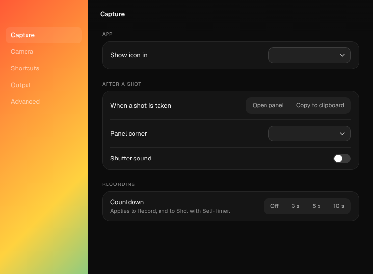
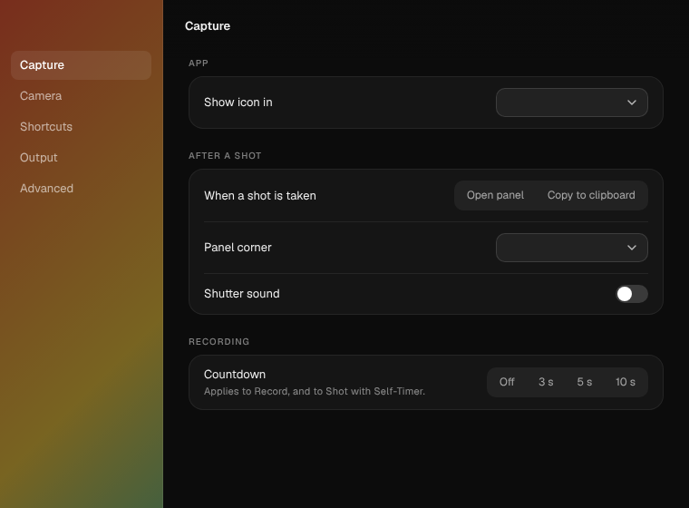

# STC-594 — a native glass sidebar for Settings

**Status: built behind a flag, waiting on the Mac run below.** If the run says
yes, the flag's look becomes the default on this ticket. If it says no, the
flag comes out.

## Why the sidebar, when STC-586 said no to the title bar

STC-586's blocker was that a native view sits behind or in front of the page's
one Chromium surface, never between the pane and the bar. So a glass bar could
only blur the desktop, never the pane scrolling under it. Nothing scrolls under
the sidebar. Its glass shows the desktop behind the window, which is exactly
what a macOS sidebar does. That needs only public API: Electron's
`vibrancy: "sidebar"` (one `NSVisualEffectView` behind the page), with no
`transparent: true` window and no electron-liquid-glass.

## What is built

`STC_GLASS_SIDEBAR=clear|tint` (macOS only; off, and unchanged, otherwise):

- `settings-window.ts`: the window gets `vibrancy: "sidebar"`,
  `visualEffectState: "followWindow"` and a clear `backgroundColor`, and tells
  the page `?glass=clear|tint`.
- `settings.html`: the page leaves only the 180 px sidebar unpainted. The
  panes, cards and the STC-586 CSS title bar (which only covers the pane) stay
  as they are.
  - `clear`: the sidebar is the bare material.
  - `tint`: a 55% dark wash over the material.
  - Under Reduce Transparency (main's `nativeTheme`, or the media query) the
    sidebar is painted `--side`, as it is without the flag.

Why two looks: the native material follows the system's Light/Dark
appearance, and Electron has no per-window appearance, while Settings is
dark-always. In Light mode `clear` should go light under dark-window text.
`tint` is the hedge.

## What Linux could show

The page side only. Over a loud stand-in for the desktop, with the flag on,
only the sidebar lets it through (`docs/stc-594/`):

| clear | tint |
|---|---|
|  |  |

The mock does not blur, desaturate or darken the way the material does, so it
overstates how loud `clear` is. It still shows the risk: `--ink-dim` labels
straight on a bright desktop.

## Library

STC-584's spec has no sidebar. The filter and search live in a sticky glass
title bar, which STC-586 already answered (CSS). So this applies to Settings
only, unless the Library design grows a sidebar.

## Runbook (Mac)

Run it from `claude/brave-brown-z2zjmb` until the PR merges, then from `master`:

```
git fetch origin claude/brave-brown-z2zjmb && git checkout claude/brave-brown-z2zjmb
npm ci
STC_GLASS_SIDEBAR=tint npm run app:start     # then the same with =clear, then unset
```

Open Settings from the library's gear. The terminal prints one line saying
what the flag did: `[settings] glass sidebar: tint (vibrancy "sidebar";
Reduce Transparency off)`. No line means the flag never reached the app (wrong
branch, or the variable was not on the same command). `OFF` or `Reduce
Transparency ON` says why there is no glass.

Start with `clear`, over something bright and colourful (a photo, a white web
page), and drag the window across it: in Dark mode the material is very dark
already, so over a dark desktop, and with `tint`'s extra wash, it can be hard
to tell from the solid sidebar.

1. **The look.** In both `tint` and `clear`, the sidebar shows the desktop
   through it, blurred, and nothing else in the window does. Pick one, or
   neither. Screenshot each with ⌘⇧4 then Space, then click the window.
2. **Light mode.** System Settings › Appearance › Light, with Settings open.
   Is the sidebar still dark enough for its labels in each? (`clear` is the
   one expected to fail.)
3. **The seam.** The 1 px hairline between sidebar and pane, and the title
   bar's left edge at 180 px, line up without a gap where the glass shows.
4. **Traffic lights and drag.** The lights sit on the glass where they sat on
   the opaque sidebar. Dragging from the sidebar's empty space still moves
   the window. Sidebar items still click.
5. **Focus.** Tab to a sidebar item: the blue ring is drawn and readable on
   the glass.
6. **Inactive window.** Click another app. `followWindow` should turn the
   sidebar to its inactive look. Say whether that reads as correct or as a
   flash.
7. **Reduce Transparency.** System Settings › Accessibility › Display ›
   Reduce transparency, with Settings open: the sidebar goes solid dark,
   the same as without the flag.
8. **Nothing else moved.** Unset the flag and relaunch: Settings looks as
   it does on `master`.

If 1 to 7 come back fine for one look, that look becomes the default and the
flag is removed. If the answer is no, the flag and this code come out.
